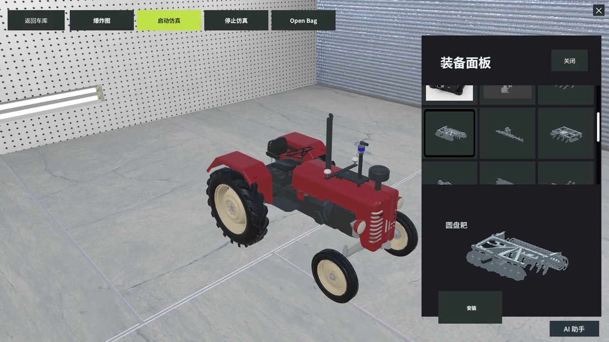
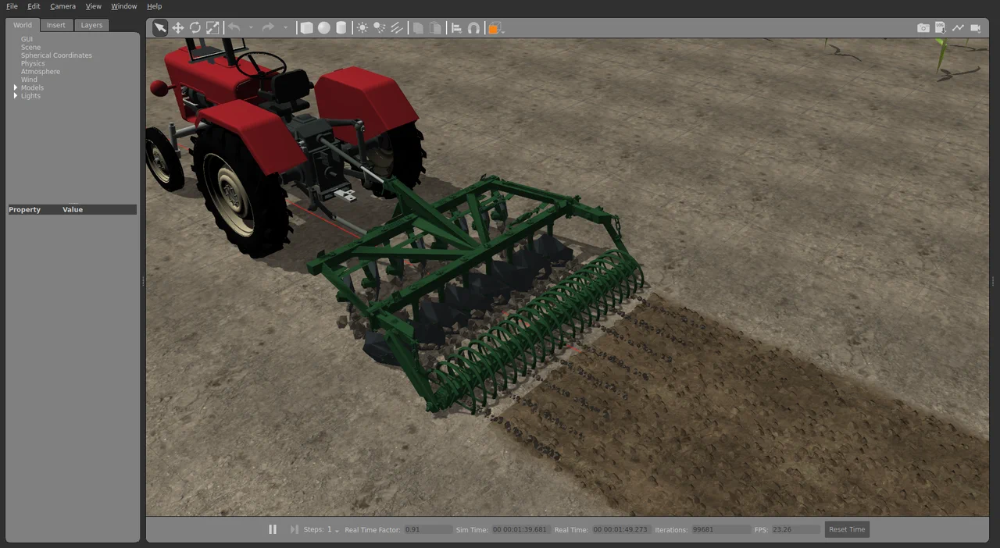
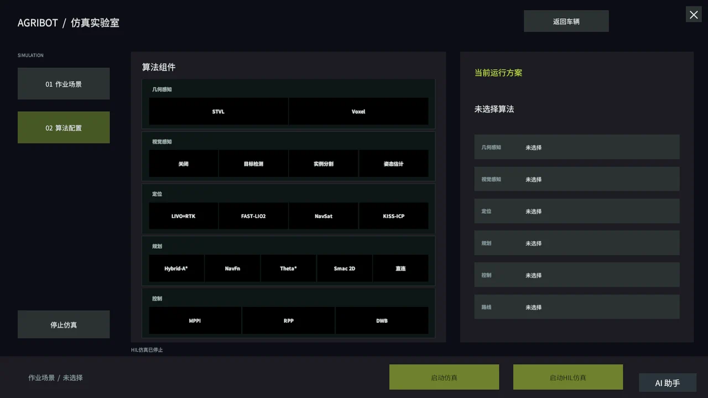
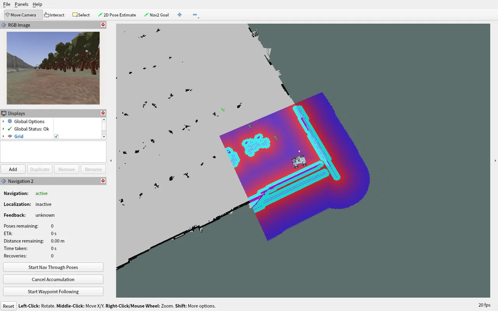
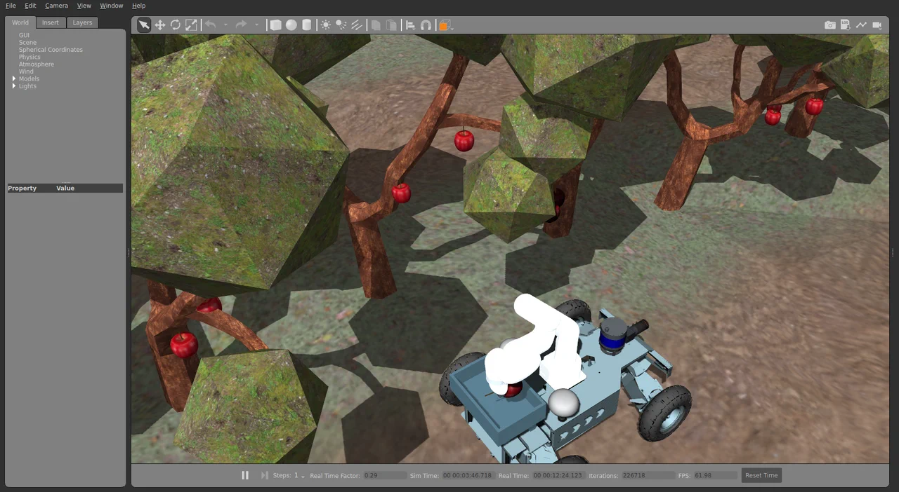
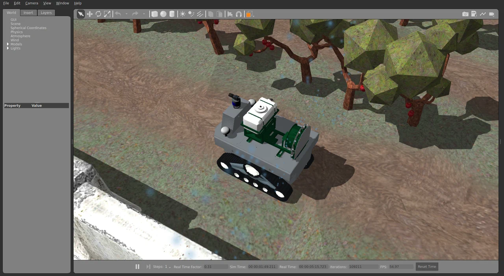
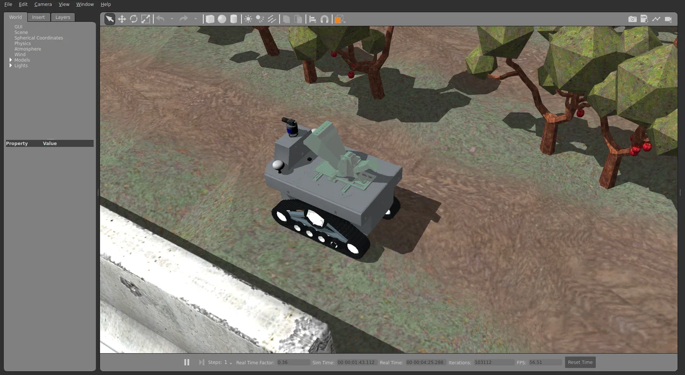
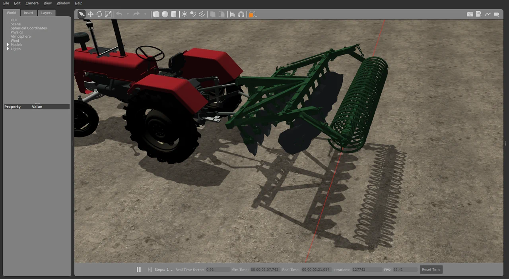

# 农机配置与算法仿真软件

**从三维车库选装，到仿真田间作业。** 在 Unity 中为农机搭配传感器和机具，选择作业场景、定位与导航算法，再到 Gazebo 和 RViz 中观察车辆怎么走、机具怎么干活。既可在一台电脑上做普通仿真，也可接入控制器台架测试真实的通信与控制闭环。

[快速上手](#快速上手) · [仿真工作流](#仿真工作流) · [五种硬件在环工况](#硬件在环) · [用户手册](docs/13_user_manual.md)

| 车库选装 | 田间作业 |
| :---: | :---: |
|  |  |
| 在 Unity 中为 Car4 选配圆盘耙 | 同车型在 Gazebo 中行走、耙地 |

**10 款车型** · **57 个装配预设** · **9 个内置场景** · **5 种硬件在环工况**

## 快速上手

支持 **Ubuntu 22.04 x86_64 · ROS 2 Humble · Gazebo Classic 11**。先准备 ROS Humble Desktop 和可用的图形桌面，其他依赖见[安装文档](docs/03_installation.md)。普通仿真不需要连接硬件台架。

### 体验发布版

使用[带五工况测试记录功能的发布版](https://github.com/Guanzhen-C/agribot_report/releases/tag/v0.1.0-20261117-hil-records)。运行电脑无需安装 Unity Editor：

```bash
sudo apt-get install git zstd
git clone --depth 1 --branch v0.1.0-20261117-hil-records https://github.com/Guanzhen-C/agribot_report.git
cd agribot_report
bash scripts/bootstrap.sh
bash scripts/run_unity.sh
```

`bootstrap.sh` 会恢复并校验模型资源、构建配套 ROS 工作区、安装与源码匹配的 Linux 程序。大文件通过 GitHub Releases 分发，**不需要 Git LFS**。下载续传或离线恢复见[发布资源说明](docs/19_release_distribution.md)。

### 构建当前源码

需要 `main` 上的新改动时，克隆时改用 `--branch main`，安装并激活 Unity **6000.0.26f1**（含 Linux Build Support），然后执行 `bash scripts/bootstrap.sh --build-unity` 和 `bash scripts/run_unity.sh`。预编译包与源码版本不匹配时，安装器会拒绝安装。

AI 助手可通过 `python3 tools/configure_llm.py` 配置个人 API Key，不配置也可完成手动装配和仿真。只想运行 ROS 演示，可按[基础仿真步骤](docs/03_installation.md#基础仿真)操作。

## 仿真工作流

1. **选车与装配**：在三维车库查看阿克曼车、差速履带车或拖拉机等车型，按车型安装雷达、RTK、相机、IMU 和适配的农机具。可用爆炸图检查结构，或在支持的车型上调整几何参数。
2. **选场景与算法**：选择苹果园、宽地头等内置场景，或导入自己的扫描场景；按需搭配几何感知、视觉感知、定位、规划和控制组件。也可请 AI 助手推荐配置，应用后仍可手动调整，由用户确认启动。
3. **运行与观察**：在仿真设置页启动，使用 Gazebo 查看运动和作业，使用 RViz 设置目标或经停点并观察地图、路径和传感器数据。

| 配置算法 | 查看导航 |
| :---: | :---: |
|  |  |

例如，导入并配置[伏羲农场 104 点方案](docs/14_fuxi_farm_104.md)后，软件会载入预设经停点，由 Smac 重新规划。该扫描场景及其私人输入不随仓库分发，不影响其他场景的手动选点。

## 硬件在环

台架模式下，**仿真电脑**运行场景、车辆和虚拟传感器，**RDK X5**运行导航与作业任务，**HPM6750**运行对应工况固件。网口传输 ROS 消息，实际 CAN 链路传递命令和反馈。


| 车型与机具 | 场景 | 作业任务 |
| --- | --- | --- |
| Car0 阿克曼车 + Lite6 机械臂 | 苹果园 | 沿默认路线停靠，采摘并将果实放入果盒 |
| Car3 差速履带车 + 风送植保机 | 苹果园 | 行走与喷水联动，农具使用 ISOBUS |
| Car3 差速履带车 + 碎枝机 | 苹果园 | 行走与刀轴联动，农具使用 ISOBUS |
| Car4 拖拉机 + 圆盘耙，动力换挡 | 宽地头 | 换挡行驶、下放耙地、抬升转弯 |
| Car4 拖拉机 + 圆盘耙，CVT | 宽地头 | 连续变速、下放耙地、抬升转弯 |

| 苹果采摘 | 植保喷水 |
| :---: | :---: |
|  |  |
| **碎枝作业** | **CVT 地头转弯** |
|  |  |

以上作业图来自实际台架仿真，不是实车照片。点击 **启动HIL仿真** 后，软件对台架检查并烧录对应固件，按默认路线运行；正常停止后可在 **测试记录** 中查看本轮结果。记录覆盖整机、智能机具、自动驾驶导航三类控制器的 **30 条用例**。工况匹配、接线、自动烧录和复测步骤见[硬件在环集成](docs/18_hil_integration.md)。

> HIL 仅用于隔离台架，不连接真实车辆执行机构，不修改 X5 真车工作区。普通仿真不会烧录固件。软件不包含独立的农机控制台、网页或 Android 控车端。

## 文档与源码

| 你要做什么 | 从这里开始 |
| --- | --- |
| 安装、下载资源或排障 | [安装与构建](docs/03_installation.md) · [资源分发](docs/19_release_distribution.md) · [运行与排障](docs/08_operations.md) |
| 配车、选场景、运行一次仿真 | [完整用户手册](docs/13_user_manual.md) · [车型、机具与算法目录](docs/14_catalog_reference.md) · [仿真操作](docs/05_simulation.md) |
| 阅读代码或编写设计说明 | [大模型阅读指南](docs/00_reading_guide.md) · [详细功能说明](docs/12_detailed_functions.md) · [架构与数据流](docs/02_architecture.md) · [代码导航](docs/11_code_map.md) |
| 核对测试和交付范围 | [独立复现说明](docs/15_reproducibility.md) · [独立安装验证](verification/release_install_20261117.json) · [需规 V1.6 配套文档](docs/16_srs_v16_documents.md) · [HIL 集成](docs/18_hil_integration.md) |

[`unity/`](unity/) 是桌面工程，[`ros2_ws/src/`](ros2_ws/src/) 是配套仿真和算法包，[`scripts/`](scripts/) 提供构建与运行入口。[交付清单](manifests/delivery_scope.json)定义源码范围；第三方代码及模型沿用各自许可证，见[资源与许可证](docs/09_resources_and_licenses.md)。
