# 农机配置与算法仿真软件 用户使用手册

## 1 范围

### 1.1 标识与适用版本

本手册适用于依据《农机配置与算法仿真软件 软件需求规格说明》V1.6交付的Unity Linux桌面应用及配套ROS仿真。手册版本为V1.1，修订日期为2026年10月26日。它替代旧手册中与当前软件不一致的安装、资源、显示、导出和路径说明；原V1.0留存备查。

| 项目 | 标识 |
| --- | --- |
| 软件配置项 | AGRIBOT-CSCI |
| 需规版本 | AGRIBOT-SRS V1.6，2026-10-26 |
| 软件交付提交 | ef817ab8d4245b47d17c2a7033c2ac37151d3f53 |
| 程序运行输入提交 | 1ece53c34b29c812d2dab8a266f4400f42ced5e7 |
| 仓库 | https://github.com/Guanzhen-C/agribot_report |
| 文档标识 | AGRIBOT-SUM，V1.1（适配需规V1.6） |

软件提交号与文档版本不是同一个概念。使用者应取得该提交对应的完整工作区及匹配程序包。当前修复版已在本地安装；通过网络取件时，应确认交付方已经发布对应提交，不能将仓库默认分支的任意版本视为本手册基线。

### 1.2 系统用途和边界

软件用于选取农机、安装传感器及适配机具、查看结构、调整Car0支持的几何参数、选择场景与算法、启动和停止本机仿真，以及生成离线配置。AI助手提供文字问答和可由用户采用的候选方案。

本手册不包含手机农机控制台、真实底盘控制、CAN联调或固件烧录。机具安装表示模型装配，并不等于已经模拟真实土壤耕作、播种、喷洒、收割或采摘物理过程。机具不参与当前导航轮廓与仿真碰撞；不能据此认定真实作业具备安全净空。

### 1.3 阅读方法

首次使用先阅读第3章环境与边界、第4章安装启动，再按第5章完成配置和导航。技术维护人员可查看第5.4节命令行、交付文件和第5.6节故障恢复。界面截图为该版本软件的实际运行画面，具体窗口尺寸和用户导入场景会随使用环境变化。

## 2 引用文件

| 文件 | 用途 |
| --- | --- |
| AGRIBOT-SRS V1.6 | 需求、字段、边界和合格性规定 |
| docs/03_installation.md | 安装、ROS构建、程序安装与源码构建 |
| docs/08_operations.md | 环境、渲染、运行和日志排障 |
| docs/14_catalog_reference.md | 车型、机具、场景及算法适配目录 |
| docs/07_interfaces.md | 配置工具、文件和运行接口 |
| prebuilt/manifest.json | 程序包摘要及运行输入匹配信息 |

仓库相对路径均指本次取得的同一交付副本，不应混用另一个工作区的脚本和生成文件。

## 3 软件综述

### 3.1 软件组成和工作流程

软件包含车型与装配、场景管理、算法方案配置、配置生成与校验、仿真与导航、可视化与视觉识别、AI助手、离线配置交付、安装部署与追溯九个模块。

推荐顺序为：启动应用 → 选车 → 装齐基础传感器及需要的机具 → 选择场景 → 逐组选算法 → 启动仿真 → 核对运行就绪 → 在RViz提交目标 → 完成或取消任务 → 停止仿真 → 按需导出配置。

### 3.2 环境与资源

| 项目 | 使用条件 |
| --- | --- |
| 操作系统 | Ubuntu 22.04 amd64，系统Python 3.10 |
| 仿真基础 | ROS 2 Humble Desktop、Gazebo Classic 11、RViz和Nav2 |
| 图形 | Unity显示及Gazebo虚拟相机所需GL环境；即使gui=false，相机仍需要渲染能力 |
| 内存和存储 | 参考内存32GB；实际以所选模型、场景能够加载和运行判断，不规定统一帧率或占用上限 |
| 完整资产 | Git LFS实体资源、10车型及适配预设、9内置场景；不能只有LFS指针 |
| 源码构建 | 仅此方式需要Unity 6000.0.26f1、Linux Build Support（Mono）及有效许可证 |
| 额外视觉 | 独立Python环境及对应权重；不启用时不必启动视觉AI节点 |
| 在线助手 | 私人凭据及允许的HTTPS服务可达；不影响离线手动配置 |

扫描场景在解压前检查剩余空间：低于ZIP声明解压体积的三倍加1 GiB时拒绝转换。应为源码、LFS资源、编译缓存、程序、地图和日志分别保留余量，不只按压缩包大小估算。

### 3.3 状态和安全操作

| 表现 | 含义与操作 |
| --- | --- |
| preparing | 同步或编译流程占用；等待处理，不重复启动 |
| running | 已登记的受管会话存活，不等于导航已经就绪或目标已完成 |
| stopped | 没有存活受管会话；允许按入口条件重新配置、导出 |
| 仿真启动任务已提交 | 仅表示外部启动进程已创建，继续检查地图、消息与导航生命周期 |
| 助手正在思考 | 当前请求未结束，等待成功或错误反馈，不重复发送 |

关闭配置面板、返回车库、关闭RViz和退出Unity都不等于停止受管仿真。结束运行时先取消必要的导航任务，再点“停止仿真”，确认stopped后退出应用。不要使用全局killall影响其他用户或任务。

### 3.4 数据与隐私

Key放在环境变量或本机私有配置中，不写入项目、截图或对话。在线请求会发送用户文字及相关配置上下文，不应输入保密任务或设备口令。原始扫描ZIP保留；删除场景只处理受管目录及可清理的派生缓存。

## 4 软件入门

### 4.1 取得匹配版本与预检

先取得交付方提供的版本化工作区，或从已经发布了对应版本的仓库克隆。以下命令均在该副本根目录执行，示例目录名为agribot_report。

```bash
git clone https://github.com/Guanzhen-C/agribot_report.git
cd agribot_report
git rev-parse HEAD
git lfs install --local
git lfs pull
python3 tools/doctor.py --unity --hashes
```

将实际提交与交付清单核对。预检应无issues；若有LFS指针、缺模型或摘要不符，先补齐资源，不用空模型绕过检查。网络慢时可使用仓库提供的tools/fetch_lfs_media.py恢复LFS，但仍须核对摘要。

### 4.2 安装与程序启动

安装前应已具备ROS Humble Desktop及相应软件源；系统依赖阶段需要管理员授权。完整安装会执行系统依赖、LFS和资产检查、ROS构建、视觉环境准备及匹配程序安装。

```bash
bash scripts/bootstrap.sh
bash scripts/run_unity.sh
```

已正确安装系统依赖时可用bootstrap.sh --skip-system；明确不使用额外视觉AI时可用--skip-vision。不要把跳过阶段的运行当成完整系统安装验证。--skip-unity-build会跳过应用安装或构建阶段，不是普通用户安装程序的默认选项。

已有dist/unity目录时安装器拒绝覆盖。先退出程序并把旧目录改为备份名称，再安装匹配版本。不要覆盖正在运行的可执行文件。

需要从源码重建时：

```bash
python3 tools/doctor.py --unity --hashes
export UNITY_EDITOR=/path/to/6000.0.26f1/Editor/Unity
bash scripts/build_unity.sh
```

发布式构建要求运行源码和资源版本固定，构建前后指纹一致。安装预编译包不需要Unity Editor或许可证，不要把两种路径混为同一前提。

### 4.3 环境加载和通信

```bash
source scripts/env.sh
printf '%s\n' "$AGRIBOT_REPORT_ROOT" "$AGRIBOT_ROS_WORKSPACE"
printf '%s\n' "$AGRIBOT_SCANNED_SCENE_ROOT" "$XDG_STATE_HOME"
```

env.sh按脚本所在位置确定工作区，不跟随当前终端目录改变；只设置路径及加载已有环境，不创建仿真。多个副本并存时，确认加载的是当前副本。

Unity受管仿真默认ROS_DOMAIN_ID=37、ROS_LOCALHOST_ONLY=1；可通过AGRIBOT_SIM_ROS_DOMAIN_ID和AGRIBOT_SIM_ROS_LOCALHOST_ONLY覆盖。观察终端必须使用与实际运行进程一致的DDS域、RMW_IMPLEMENTATION及CYCLONEDDS_URI。基础smoke检查另用域93，不把它的/clock与交互仿真混用。

### 4.4 程序关闭、仿真停止与重新进入

右上角“×”退出Unity。若仅要关当前面板，用面板自己的“关闭”“取消”或“返回”。先停止仿真再退出；再次打开应用是新的应用会话，不恢复旧聊天或自动运行旧目标。

```bash
source scripts/env.sh
bash "$AGRIBOT_ROS_SYNC_SCRIPT" --status
bash "$AGRIBOT_ROS_SYNC_SCRIPT" --stop
```

终端独立启动的ros2 launch应在原终端Ctrl+C结束；它不一定属于Unity登记的受管会话，不能仅靠Unity状态判断它是否已停止。

## 5 使用指南

### 5.1 车型选择与三维观察

在车库按“全部车型”“阿克曼转向”或“履带差速”筛选；目录超出窗口时滚动查看。Car0、1、2、4、5、6、7、8属于阿克曼分类，Car3和Car9属于履带差速。点击卡片进入相应单车页，等待展示完成。

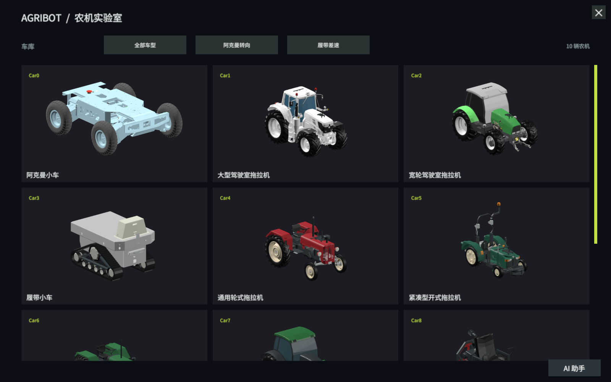

单车区内左键拖动改变观察方向，滚轮改变远近；在按钮、滑条和面板上操作时，不应同时旋转车体。装配和观察是不同操作，拖动视角不改变安装坐标。返回车库后再选车会按新页面建立装配，不能把隐藏旧模型当作当前车辆。

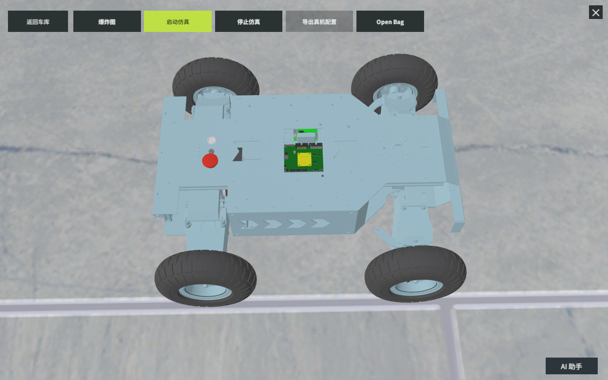

### 5.2 传感器和农机具

1. 点击Open Bag打开装备面板；该英文文字对应装备入口。
2. 点选雷达、RTK、相机或IMU，查看详情后点“安装”。
3. 等待动画完成，确认车上出现模型，当前条目变为“卸下”。
4. 按同样方式安装四类基础传感器，再选需要的适配机具。
5. 关闭装备面板，核对模型及后续操作栏。

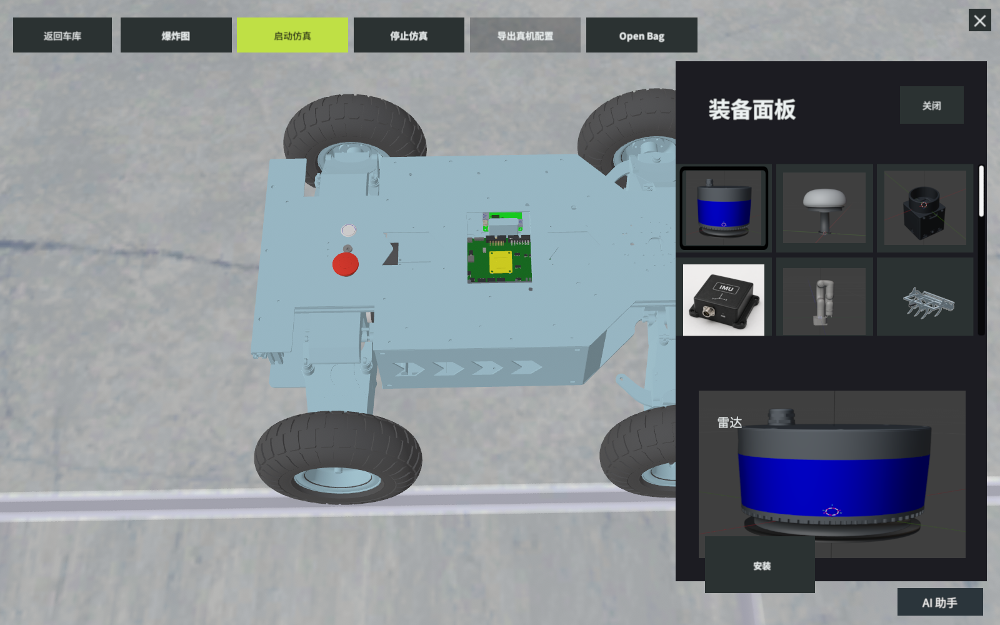

常规导出要求四类基础传感器均安装，不能因选择某种定位就绕过当前装配检查。传感器采用程序预设安装位置；这里不提供自由拖拽标定。安装不会缩放真实几何配置，较大机具可改变观察取景。

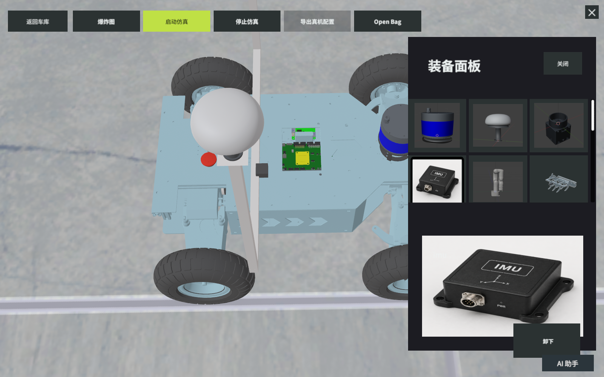

机械臂与夹爪适配Car0和Car3。其他机具按车型目录适配并互斥替换；不可安装项的按钮不可用。Car8可装前置割草刀杆，Car9可装谷物收割割台。机具名称不表示已实现对应生产作业或真实安全碰撞。

### 5.3 Car0修理参数和爆炸图

Car0单车页在非UI的车身位置双击打开修理面板。普通单击或中间夹杂配置面板操作不应拼成双击。其他车型未提供该专属修理面板时双击不执行此操作。

参数图标首次点击显示“再次点击…”提示，再次点击同一图标进入调整页。单位和范围如下：

| 参数 | 调整范围 | 使用注意 |
| --- | --- | --- |
| 轮胎半径 | 7.00～17.00 cm | 原本半径快捷值为12.75 cm |
| 前后轴距 | 0.42～0.60 m | 指前后轮中心纵向距离，不是左右轮距 |
| 横向轮距 | 59～70 cm | 当前页面回显文字为“当前轴距”，含义仍是横向轮距 |

Car0前后轴距还可输入数值，按页面确认操作完成；非法格式、超过允许小数位数和越界值按提示修改。改几何参数后需重新导出，旧仿真结论不能直接复用。

点击“爆炸图”后拖动滑块观察部件展开；收起或退出后恢复装配位置。Car0保留细分零件，其他车型按现有模型层级展开。爆炸状态用于展示，不作为传感器安装位姿导出。

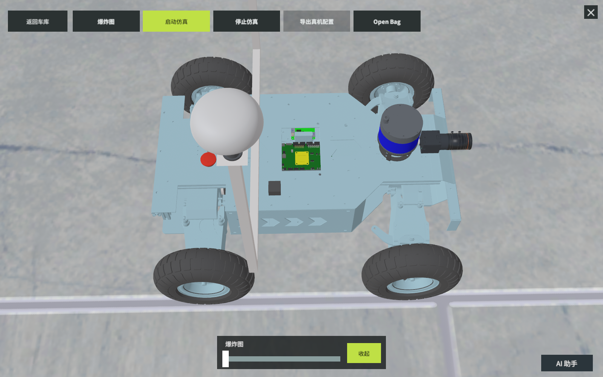

### 5.4 场景选择、扫描导入和删除

单车操作栏点击“启动仿真”先打开配置页，不会仅因打开页面就运行。进入“01 作业场景”，点击场景卡片并核对底部名称。内置有苹果园、玉米试验田、温室行间、农场运输区、番茄温室、草莓种植区、葡萄园、蔬菜试验田和宽地头机具运输区。

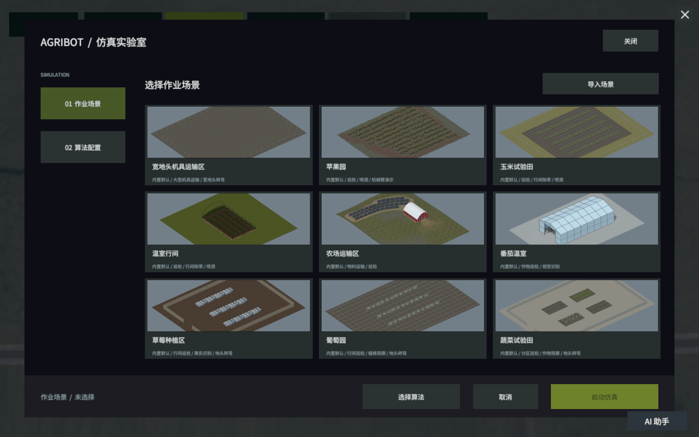

导入时准备受支持的ZIP：一份LCC2索引、引用的SOG高斯数据、PLY碰撞网格及有效扫描位姿。扫描必须有用于地图生成和车辆出生点的地面。任意PLY、STP或FBX不属于此场景导入入口支持的输入。

1. 点击“导入场景”，输入1～48字符名称，去掉首尾多余空白。
2. 点击“选择 ZIP”，在系统文件选择器中选择原始包。
3. 点击“导入”，观察校验、转换及资源准备进度，不重复提交。
4. 成功后查找“用户导入”卡片，核对名称、预览和底部当前选择。
5. 失败时修正格式、数据或环境，不能把目录中的同名旧缓存当作本次成功。

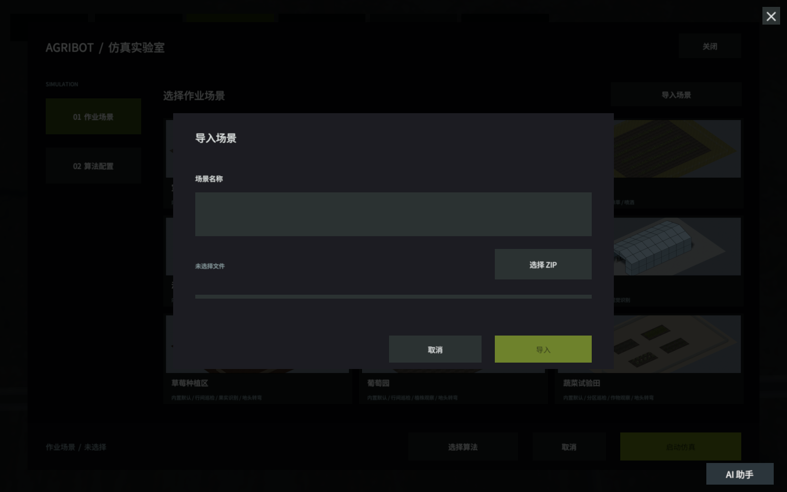

未完成转换时可取消；取消后不应产生可用场景卡片。新进程保留已完成导入目录，但当前选择重新从“未选择”开始。名称重名会被拒绝；同一ZIP可在不同名称下引用共享缓存。

删除前先停止使用该场景的仿真。点击用户卡片右上角×，阅读确认后删除；取消不改变目录。最后一个引用删除后才清缓存，原始ZIP不删除。内置场景没有这个删除入口。

运行导入场景前核对实际选中的是该场景，地图与world对应，出生点具有地面支撑。自动化所园区属于用户输入，不是程序内置第十个场景；没有导入它时不能用其他空场景验收其显示效果。

### 5.5 选择五组算法

进入“02 算法配置”，各组选一项并查看当前方案。首次进入新应用会话时各组未选择；“关闭额外视觉感知”是一项有效选择，不是漏选。

| 组 | 选项 | 边界 |
| --- | --- | --- |
| 几何感知 | STVL、Voxel | 激光点云障碍表示 |
| 视觉感知 | 关闭、目标检测、实例分割、人体姿态估计 | 独立显示，不参与运动控制 |
| 定位 | FAST-LIVO2+RTK、FAST-LIO2、NavSat ESKF、KISS-ICP | 按车型和场景适配选择 |
| 规划 | Smac Hybrid-A*、NavFn、Theta*、Smac 2D、直连 | 直连仅对显式预置路线；普通RViz目标仍按规定规划 |
| 控制 | MPPI、RPP、DWB | 使用对应运动模型及车辆约束 |

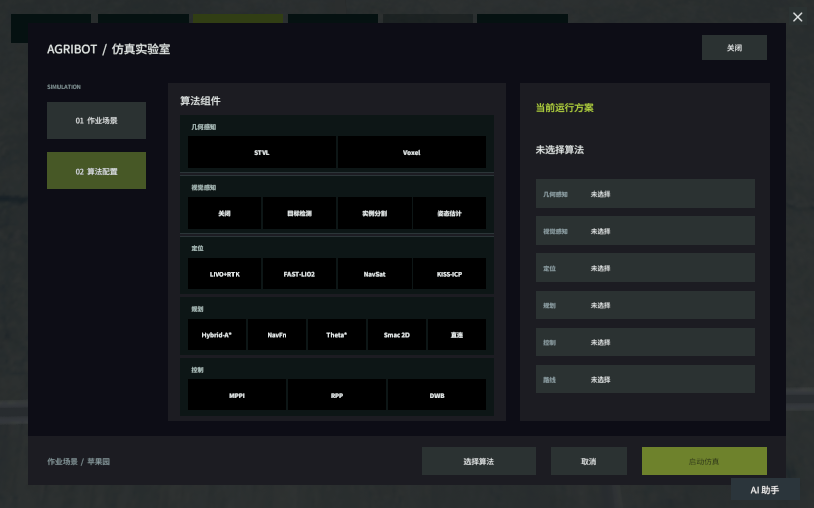

优先采用已验证的组合。Car0苹果园的常用组合为STVL、关闭额外视觉、FAST-LIVO2+RTK、Smac Hybrid-A*、MPPI。宽地头等稀疏环境采用目录要求的NavSat方案；大车应先检查道路净空和转弯空间。菜单可选、ID合法或节点启动成功不表示任意组合均可完成全程。

### 5.6 启动仿真和确认运行就绪

1. 装齐必需传感器，等待展示和装配动画结束。
2. 确认所选场景、车型、机具和五组算法。
3. 点击配置页“启动仿真”，等待配置导出、校验、增量构建和进程启动。
4. 查看Gazebo和RViz，核对本轮车型、场景、地图与图像。
5. 进一步核对消息和导航服务就绪，再提交目标。

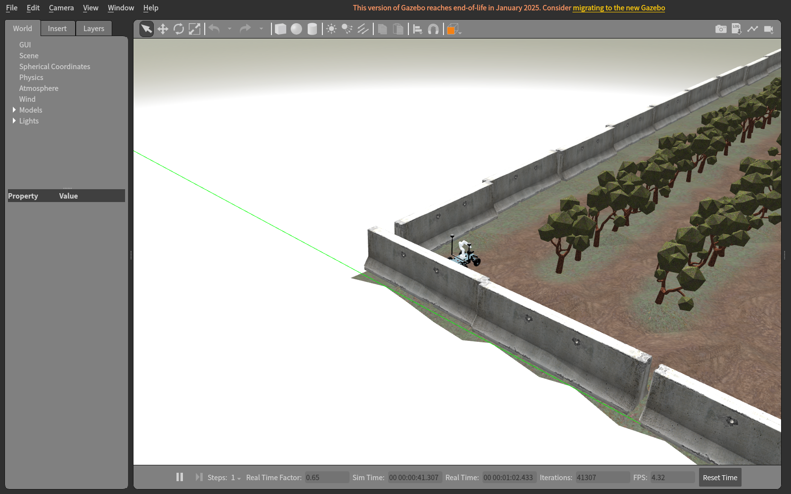

在同一仿真通信域的终端检查：

```bash
source scripts/env.sh
ros2 topic echo /clock --once --no-daemon
ros2 topic list --no-daemon
ros2 lifecycle get /planner_server
ros2 lifecycle get /controller_server
ros2 lifecycle get /bt_navigator
ros2 action list -t
```

默认观察域为37。若用环境变量覆盖过实际受管域，应将观察终端切到相同域和DDS配置。地图和定位需有实际消息，三个导航生命周期应为active，并可发现/navigate_to_pose和/navigate_through_poses。running状态或一条/clock消息不等于全部就绪。

### 5.7 RViz单目标、连续经停点和停车

单目标：在Navigation 2的普通模式选择Nav2 Goal，在地图可通行区域点下并拖动方向，释放后提交。为车体尺寸和转弯半径留足空间。观察规划路径、任务反馈和车辆移动；无法规划或中止应返回非成功状态。

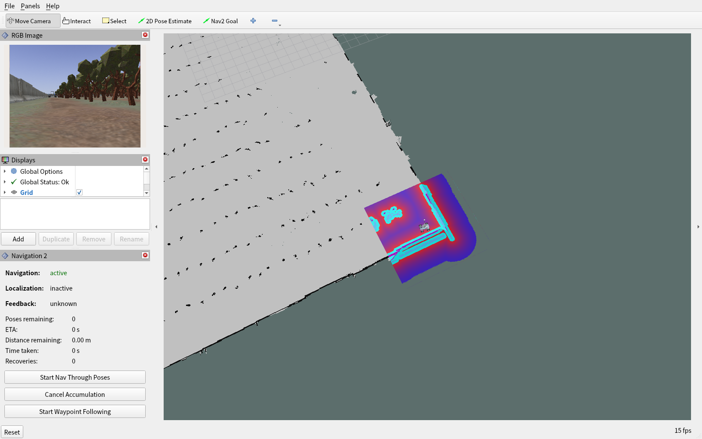

本方案使用外部融合定位。Navigation 2面板的Localization字样不是所有外部定位器的通用健康检查；判断时仍须读取本轮所选里程计、TF及导航Action，不只根据该字样。RGB图像停靠区过小时，可拖动其与下方面板之间的分隔条放大。

连续经停点：

1. 切换Waypoint/Nav Through Poses模式。
2. 用Nav2 Goal按顺序设置位置与方向。
3. 核对地图箭头及wp_1、wp_2等顺序编号。
4. 点击Start Nav Through Poses后才提交整条连续任务。
5. 观察任务结果及末点停车；不把中途短暂停车当作整项完成。

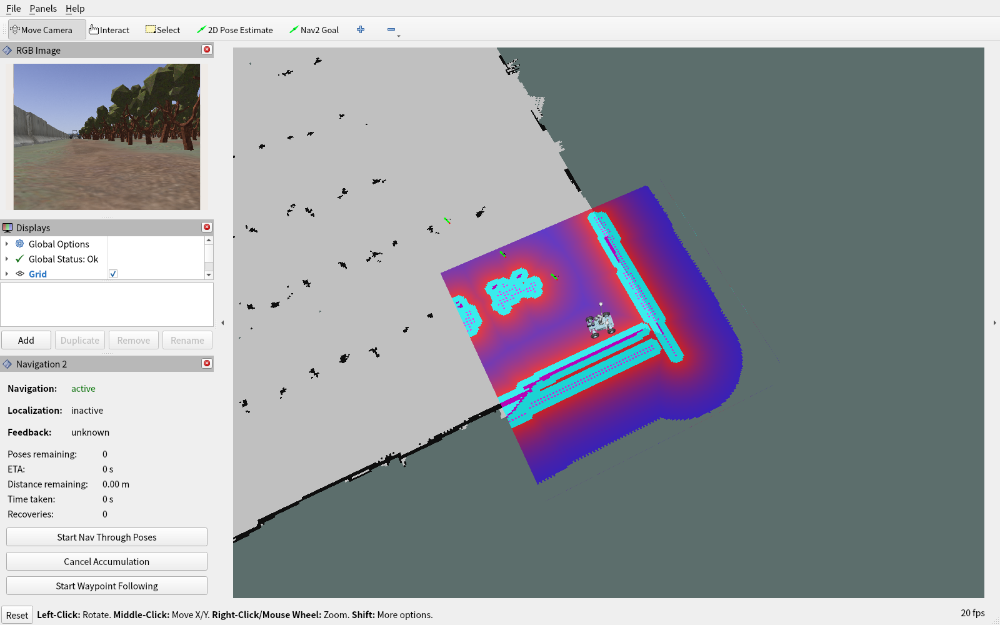

图中的三个目标仅用于展示积累模式，尚未点击启动，也未据此验证可达。实际运行应选择当前场景可通行位置，不照抄截图像素位置；箭头和wp编号可放大查看，并从/waypoints核对顺序。

不要把Start Waypoint Following和连续through-poses任务混用。直连模式不改变普通RViz连续目标的提交协议。软件不保证每个尖角点都不停通过。

最终停车位置容差为当前geometry.wheelbaseM的一半，可从/controller_server的goal_checker.xy_goal_tolerance核对。方向仍影响规划，但不以最终偏航未对齐继续绕圈。到达、取消或中止后清除本次路径显示；隐藏显示不是取消任务。

### 5.8 相机和额外视觉任务

关闭额外视觉时，RGB Image使用/camera/rgb/image_raw。选择目标检测、实例分割或人体姿态任务且环境和模型齐备时，使用/vision/annotated_image；结构化结果在/vision/results，处理计数在/vision/status。

目标检测有框与类别，实例分割有实例掩膜，人体姿态有关键点或骨架。没有检测到目标允许输出空objects；不能因为画面空旷就伪造类别。相机图像时间戳及frame_id应与该处理帧的结果一致。

关闭额外视觉不会关闭FAST-LIVO2所用定位相机。视觉任务不向Nav2写语义障碍，不直接发布车体速度，也不承诺指定农作物检出率。

### 5.9 AI助手和方案采用

首次使用在线助手前运行python3 tools/configure_llm.py设置自己的Key，或使用DEEPSEEK_API_KEY/AGRIBOT_LLM_CONFIG指定私有配置。不要在截图中暴露Key。

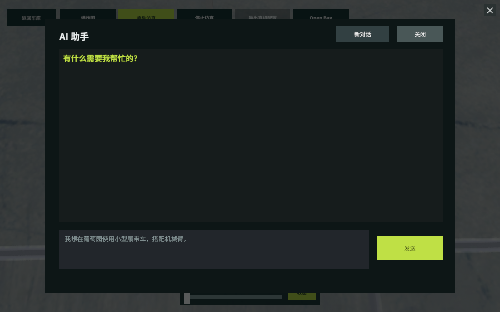

输入问题后Enter发送，Shift+Enter换行；中文输入法先完成候选确认。也可点击发送。请求期间不重复提交，关闭面板不取消后台请求；请求结束后输入控件恢复。

示例：“使用Car0在苹果园巡检，保持STVL和FAST-LIVO2+RTK，采用Smac和MPPI，说明这个选择的适用条件。”助手依据目录和文字状态回答，不读取当前三维画面或保证定位精度。

装配方案点“选择这套装配”，算法方案点“采用这套算法”；采用前会重新复核当前车辆、场景、机具和配置摘要。实际状态变化后旧方案可能被拒绝，应重新推荐。采用方案不自动启动仿真，仍需人工核对并另点启动。

同一进程关闭面板后保留最近80条聊天显示及未发送文字；界面操作只作为助手上下文，不作为聊天气泡。新对话清聊天、输入及助手会话记忆，但不卸装备、不删场景、不重置实际算法、不停仿真。退出重开是新会话，旧JSONL日志不自动回填，也不保证全部历史逐字进入模型上下文。

### 5.10 停止与再次启动

先按需取消导航，再点击“停止仿真”，等待“仿真已停止”并核对--status返回stopped。软件只处理自身登记的会话；停止后可返回车库换车、重装机具、修改参数或重新选场景。

检查脚本会清理本次独立会话内的父子进程，按INT、等待、TERM、等待的顺序处理，极端超时才强制终止。重复停止不应重启任务。遇到编译中停止，应等待该流程处理停止请求，不把按钮反馈等同已经完成清理。

### 5.11 配置导出和不可部署草案

“导出真机配置”是离线文件交付，不是标定、烧录或实车运行。按下表判断结果：

| 入口 | 产物与限制 |
| --- | --- |
| Car0固定兼容模板 | 固定已封装Ackermann方案及10项参数文本；不自动采用当前UI改过的几何/算法 |
| Car0含固件部署包 | 使用resources/deployment/ackermann或覆盖目录的清单、BIN、ELF；校验后导出，flashing=manual、board_verified=false |
| unity_car1～unity_car5基础ID草案 | vehicle_config.json、4个YAML、README、manifest；calibrationVerified=false、deployable=false |
| Car6～Car9或带机具后缀preset | 不在上述独立草案CLI的允许ID范围内，不能承诺导出成功；保留实际错误，不改标识绕过 |

界面导出需先停止受管仿真，并满足该入口的安装、动画与忙态条件。默认固件资源已经随本交付提供；缺失、摘要不符或板卡协议不匹配时明确拒绝，不静默改成其他类型产物。

需要纯文件封装时，可在加载环境后执行以下例子；它们不启动ROS、烧录或检查实车标定：

```bash
source scripts/env.sh
mkdir -p "$HOME/agribot_exports"
python3 -m agribot_vehicle_config_tools.cli export-physical \
  --workspace-src "$AGRIBOT_WORKSPACE_SRC" \
  --output "$HOME/agribot_exports/ackermann_physical_runtime.json"
```

带人工固件包时另加--firmware-root "$AGRIBOT_HPM_FIRMWARE_ROOT"。所有文件及manifest一起保留，不以成功文案代替产物与摘要检查。

### 5.12 文件、日志与备份

| 内容 | 默认位置或查找方法 |
| --- | --- |
| 已安装程序 | 交付根dist/unity |
| 扫描场景及缓存 | 交付根.local/scanned_scenes；可由AGRIBOT_SCANNED_SCENE_ROOT覆盖 |
| 受管会话状态和latest.log | 交付根.local/state/agribot-unity-sim；状态根由AGRIBOT_REPORT_STATE_HOME覆盖 |
| ROS编译日志 | 当前副本ros2_ws/log |
| ROS运行日志 | 当前ROS日志目录，通常~/.ros/log |
| Unity构建日志 | 交付根.validation/unity_build.log |
| 当前装配导出 | 本次提示的ConfigExports/车辆ID；独立应用相对persistentDataPath，不假定与Editor目录相同 |
| 助手历史 | persistentDataPath/assistant_sessions/*.jsonl，保留旧会话，不写Git |
| 私有模型服务配置 | 交付根.local/llm.json，或AGRIBOT_LLM_CONFIG覆盖路径 |

```bash
source scripts/env.sh
tail -n 100 "$XDG_STATE_HOME/agribot-unity-sim/latest.log"
cat "$XDG_STATE_HOME/agribot-unity-sim/status"
```

升级前备份原始ZIP、用户导出、当前安装程序与私有配置。保留问题发生时的日志和版本，不覆盖旧证据。不要把另一个工作区的generated目录当成本次输出。

### 5.13 错误恢复与快速参考

| 现象 | 处理步骤 |
| --- | --- |
| 启动不可点 | 逐组补齐选择、选场景，等待导入/删除及装配结束 |
| 报缺传感器 | 关闭配置页，装齐四类基础传感器，等待动画，再启动 |
| 有running但不动 | 检查地图、定位、Nav2生命周期及是否已提交目标；默认不自动跑预置点 |
| 相机No Image | 查话题、消息、QoS和GL；gui=false也需要传感器渲染环境 |
| 扫描场景车下落或画面暗 | 核对是否导入并选中正确场景，world/map及出生点地面支撑，保留原始ZIP和日志 |
| 规划失败或转弯困难 | 检查净空、车体大小、最小转弯半径及场景适用性，不缩碰撞体强行通过 |
| 数值输入被拒 | 按提示检查字段路径、单位、有限值、范围；使用合法输入重新执行 |
| 固件或草案导出失败 | 对照适用ID、停止状态、固件清单/大小/摘要，不伪造标定或可部署标记 |
| 助手超时或Key错误 | 修正私人配置/网络；关闭助手继续手动操作，不把旧卡片当作新成功方案 |
| 程序包与源码不匹配 | 使用同一基线重新安装或源码构建，不给旧程序补写新指纹 |
| 旧节点残留 | 先用本副本--stop处理登记会话；独立终端任务在其原终端结束，避免全局杀进程 |

基本检查命令为source scripts/env.sh、python3 tools/doctor.py --unity --hashes、受管脚本--status与--stop。bash scripts/smoke_simulation.sh仅检查固定Car0苹果园的进程与/clock并清理，不是路径精度、全程导航或所有组合验证。

ROS构建可用AGRIBOT_BUILD_PACKAGE_WORKERS和AGRIBOT_BUILD_JOBS_PER_PACKAGE调整资源；显式--parallel-workers和非空CMAKE_BUILD_PARALLEL_LEVEL按需规优先，不建议盲目将并发开满导致内存不足。

### 5.14 配置文件工具参考

下列入口面向需要检查导出结果的维护人员，不代替普通用户的界面装配。先加载同一交付副本的scripts/env.sh。INPUT、EXPORT和OUTPUT分别替换为实际JSON文件、Unity导出目录和独立输出目录；有空格或中文时始终保留双引号。

```bash
python3 -m agribot_vehicle_config_tools.cli --help
python3 -m agribot_vehicle_config_tools.cli validate "$INPUT"
python3 -m agribot_vehicle_config_tools.cli generate "$INPUT" \
  --output "$OUTPUT" --workspace-src "$AGRIBOT_WORKSPACE_SRC"
python3 -m agribot_vehicle_config_tools.cli import-unity "$EXPORT" \
  --canonical "$CANONICAL_JSON" --output "$OUTPUT" \
  --workspace-src "$AGRIBOT_WORKSPACE_SRC"
python3 -m agribot_vehicle_config_tools.cli verify-current "$INPUT" \
  --workspace-src "$AGRIBOT_WORKSPACE_SRC" --json-report "$REPORT_JSON"
```

validate只读校验，不生成、不启动；成功返回0并输出OK、路径、vehicleId及schema，允许同时有WARNING。无效输入返回2及ERROR原因。generate和import-unity的输入与输出目录应分离，输出先用空目录；import-unity需要非空vehicle_visual.obj和vehicle_visual.mtl，缺件时先修复导出。

verify-current比较当前输入推导值与固定Ackermann基线，不自动替换基线。PASS/FAIL可能同时出现，应查看expected、actual和source，不要求任意改过的几何都与固定基线相等。配置单位为米与弧度，schemaVersion为字符串1.0，coordinateConvention为ROS_FLU。

检查manifest中files的相对路径、实际字节数和SHA-256，不能只看文件数。未指定工作空间模板时runtimeTemplatesApplied应为false。同样的输入、相邻资源、生成器和选项写到两个空目录，应得到相同文件集合及同名文件摘要。

适用Car1～Car5基础ID的草案命令为：

```bash
python3 -m agribot_vehicle_config_tools.cli export-physical-draft "$INPUT" \
  --output "$OUTPUT"
```

输出的不可部署标记是正确结果，不能人工改成已标定来绕过检查；其他ID的错误须按实际接口处理。

## 6 注释与问题报告

ROS_FLU表示x向前、y向左、z向上；长度默认以米、角度以弧度。光学坐标和各传感器测量坐标通过其frame及安装变换表示，不根据模型壳体外观猜测朝向。

Action的SUCCEEDED、CANCELED和ABORTED分别表示目标成功、取消和中止；它们与受管会话的running/stopped不同。地图上没有路径不等于整个ROS系统已停止。

报告问题时提供软件提交、程序build-info、操作系统和图形环境、车型/机具/场景来源、五组算法、操作顺序、实际提示、ROS域、相关日志及截图。可以脱敏，但不要删除定位问题所需的字段名、退出码或时间关联；不要附带Key和密码。
